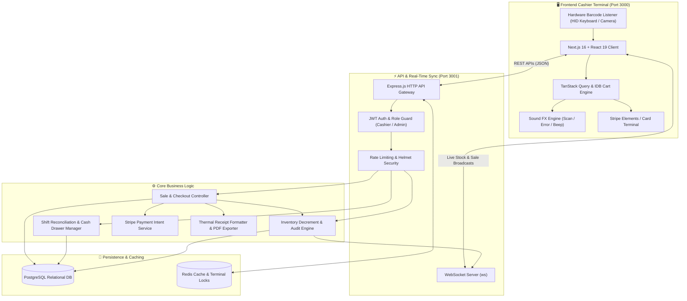
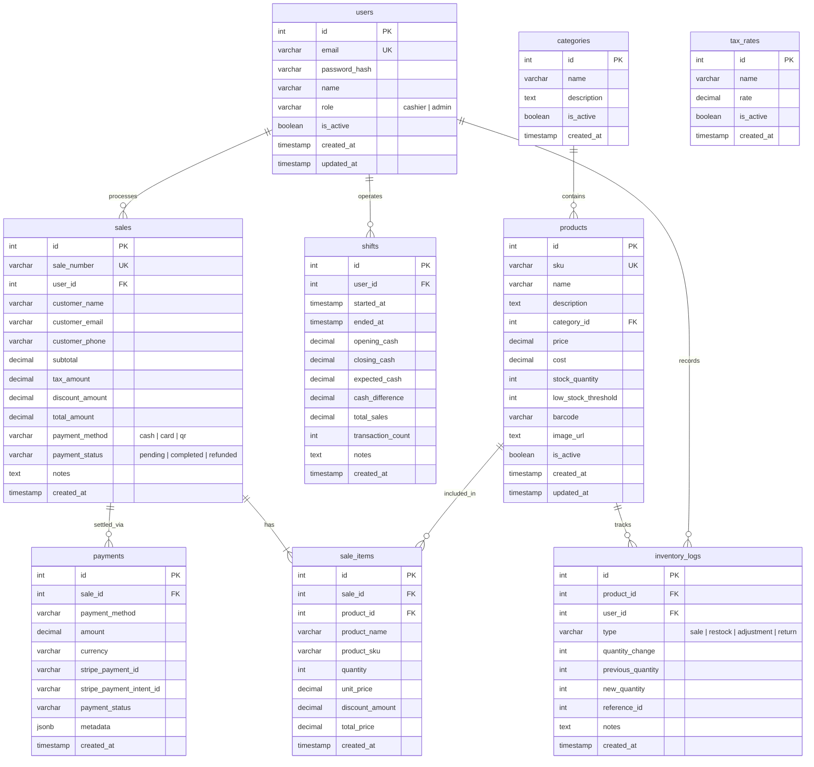
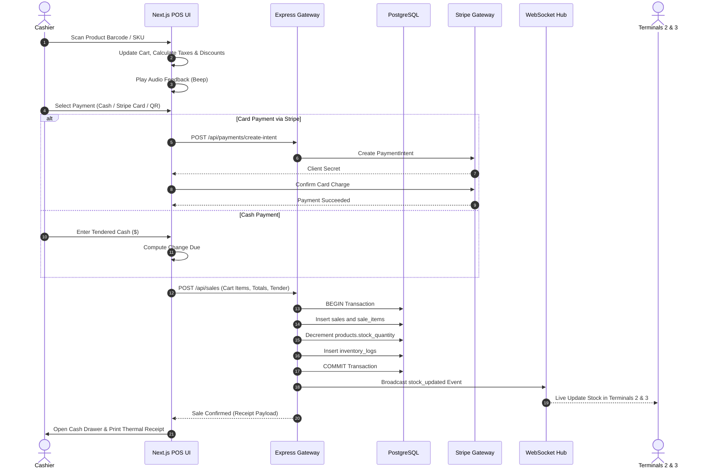

# Apex POS — High-Speed Retail Point of Sale & Inventory Engine

<div align="center">


**A high-performance retail point-of-sale terminal with barcode scanning, hold/recall orders, cash drawer reconciliation, Stripe payments, thermal receipts, and real-time WebSocket inventory synchronization.**

[Live Architecture](#-system-architecture) • [Database ERD](#-database-entity-relationship-diagram) • [Transaction Sequence](#-transaction--checkout-sequence) • [Quick Start](#-quick-start)

</div>

---

## ⚡ Overview

**Apex POS** is engineered for modern retail, supermarkets, and hospitality environments requiring millisecond-level responsiveness. It delivers an offline-tolerant cashier interface paired with an event-driven Express backend, ensuring instant product lookup, real-time stock sync across multiple terminals via WebSockets, and strict cashier shift audits.

---

## 🏗 System Architecture



---

## 📊 Database Entity-Relationship Diagram



---

## 🔄 Transaction & Checkout Sequence



---

## 📦 Key Capabilities

- **High-Velocity Scanning**: Sub-50ms barcode debounce with audio feedback and automatic keyboard-wedge listener.
- **Order Hold & Recall**: Park interrupted orders when customers need more items and recall them instantly without cart data loss.
- **Real-Time Multi-Register Sync**: WebSocket broadcast pushes inventory changes immediately across all active terminals to avoid stock-outs.
- **End-of-Day Shift Closeout**: Register opening float, cash drop tracking, expected vs. counted variance, and cashier audit logs.
- **Multi-Rail Payments**: Supports Cash with automatic change calculation, Stripe Payment Intents, and digital QR codes.
- **Offline Reliability**: IndexedDB cart persistence preserves in-progress transactions even during intermittent network dropouts.

---

## 🚀 Quick Start

### Prerequisites
- Node.js >= 20.x
- PostgreSQL instance running locally or via Docker
- Redis instance
- `pnpm` (`npm install -g pnpm`)

### 1. Backend Setup
```bash
cd backend
pnpm install

# Configure Environment
cp .env.example .env
# Set DATABASE_URL, REDIS_URL, STRIPE_SECRET_KEY, and JWT_SECRET

# Run DB Migrations & Seeds
pnpm run migrate
pnpm run seed

# Start API Server (Port 3001)
pnpm run dev
```

### 2. Frontend Cashier Setup
```bash
cd ../frontend
pnpm install

# Start Next.js App (Port 3000)
pnpm run dev
```

Visit `http://localhost:3000` to launch the POS terminal.

---

## 🛡️ Security & Auditing

- **Role-Based Access Control**: Strict segregation between `cashier` (sales only) and `admin` (pricing, shifts, inventory adjustments).
- **Immutable Inventory Trail**: Every stock change creates a signed `inventory_logs` record tied to the responsible user and transaction ID.
- **Rate-Limiting & Helmet**: Hardened HTTP headers and API brute-force protection.

---

## 📄 License
Proprietary & Confidential — Engineered by **[Ros Rendo](https://github.com/RosRendo)**